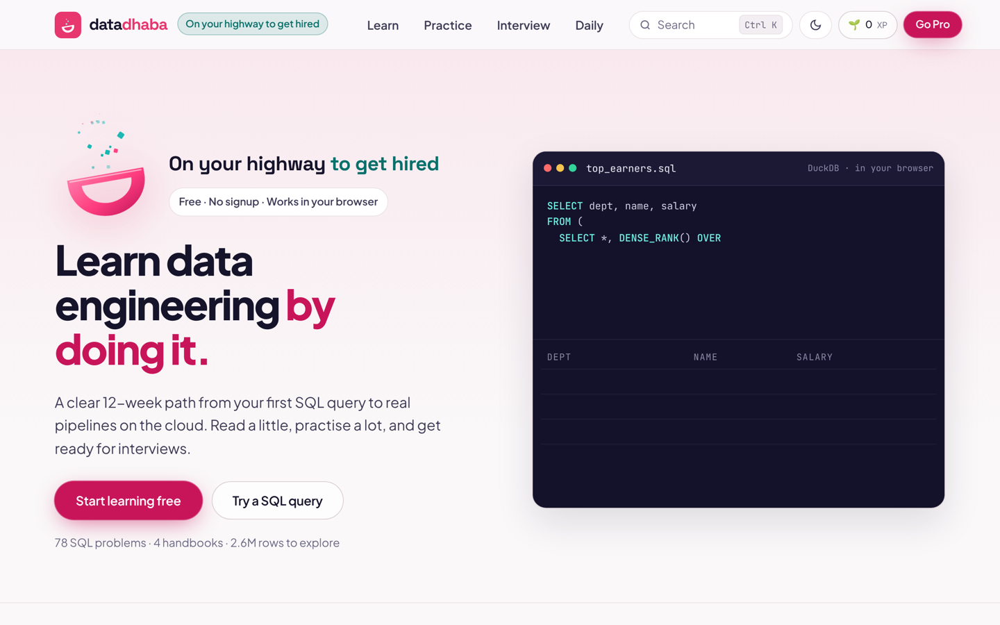
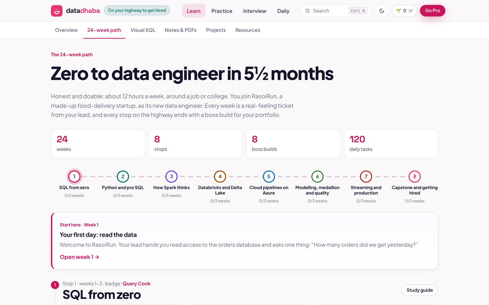
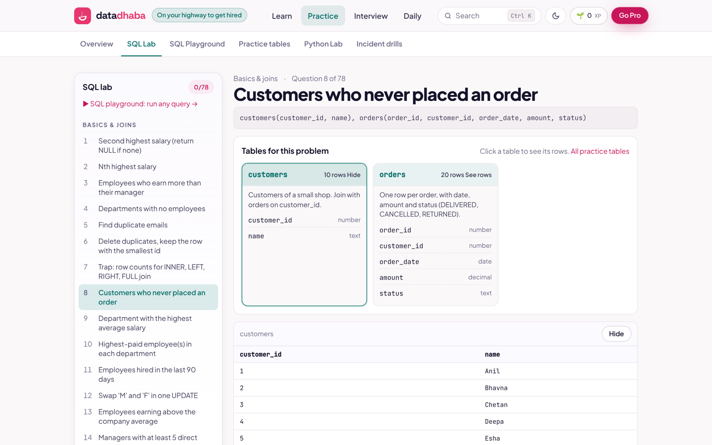

<p align="center"></p>

<h1 align="center">Data Dhaba</h1>

<p align="center"><b>On your highway to get hired.</b><br/>Learn data engineering by doing it, right in your browser. Free, forever.</p>

<p align="center">
  <a href="https://sagarkonkanagaon-netizenk.github.io/data-dhaba/"></a>
  <a href="https://sagarkonkanagaon-netizenk.github.io/data-dhaba/#/path"></a>
  <a href="https://sagarkonkanagaon-netizenk.github.io/data-dhaba/#/pro"></a>
</p>

<p align="center">
  
  
  
</p>

---

> [!IMPORTANT]
> ### 📣 Data Dhaba Pro is coming: ₹999 for 6 months or ₹1,599 a year
> **34 end-to-end projects · 60+ cheat sheets · 500+ interview answers · AI mock interviewer · 20 system design cases.**
> Everything between "I finished the course" and "I got the offer".
> **[Join the waitlist →](https://sagarkonkanagaon-netizenk.github.io/data-dhaba/#/pro)** No payment now. You get an email the day it opens.

---

## 🛣️ Why Data Dhaba

Most data engineering courses are videos you watch and forget. Data Dhaba is a place you **do the work**:

- 🧪 **Real engines, zero setup.** SQL runs on DuckDB and Python on Pyodide, inside your browser tab. Nothing to install.
- 🧭 **A path that tells you what to do today.** 24 weeks, 8 stops, a day-by-day plan, and a ticket from your lead every week.
- 🚨 **Practice like the job.** Pipelines break at 3 AM. You get paged, you fix them.
- 🎯 **Interview-first.** Every topic ends where interviews begin: the question, the follow-up, the trap.

<p align="center"></p>

## 🍽️ What's on the menu (free)

| | What you get | |
|---|---|---|
| 🗺️ | **24-week path** (about 5½ months, ~12 h a week) | 8 stops, 8 boss builds, a badge at every stop. You join RasoiRun, a made-up food-delivery startup, and every week is a ticket from your lead. |
| 📚 | **Four handbooks**, 98 chapters | SQL, PySpark, Databricks and Streaming. Short chapters you finish in minutes. PDFs to keep. |
| 🗄️ | **SQL Lab**, 78 problems | Interview questions on a real engine, checked the moment you press Run. Every table and column shown in plain words. |
| 🧪 | **SQL Playground**, 2.6M rows | Shop orders, clickstream and taxi trips, with real-world mess on purpose: duplicates, NULLs, late events. |
| 🐍 | **Python Lab** | Data engineering coding problems with tests that check your code. |
| 🚨 | **Incident drills** | Schema drift, duplicate replays, late data, null storms, source outages. Fix the SQL, then learn the prevention. |
| 🔥 | **Daily SQL challenge** | One question a day, the same for everyone. Keep the streak, share the card. |
| 🎤 | **Interview prep** | Scenario questions with push-backs, PySpark questions, a 102-question cloud quiz, flashcards and a "tell me about yourself" playbook. |
| ✨ | **Visual SQL** | Joins and window functions, animated so they finally click. |
| 🏅 | **XP, levels and badges** | Progress saved in your browser. No account, no ads, no paywall on learning. |

<p align="center">
  
  
</p>

## 💎 Coming soon: Data Dhaba Pro

| Plan | Price | |
|---|---|---|
| **6 months** | **₹999** | about ₹167 a month |
| **1 year** | **₹1,599** | about ₹133 a month, save 20% |

Built for people who want the job, not just the certificate.

| | Pro gives you | |
|---|---|---|
| 🏗️ | **34 end-to-end projects** | Real business problems, start to finish: ingestion, lakehouse, quality, orchestration, Docker, CI/CD and a dashboard. Messy data, a brief, a build guide, a solution walkthrough and a README ready for your GitHub. |
| 📄 | **60+ cheat sheets** | One page, print-ready, for every tool and pattern a data engineer touches. |
| 💬 | **500+ interview questions with model answers** | SQL, PySpark, modelling, cloud and behavioural, each with the follow-up an interviewer asks next. |
| 🧠 | **20 data system design case studies** | Requirements, numbers, architecture and trade-offs, for the round that decides senior offers. |
| 🤖 | **AI mock interviewer** | Asks, listens, pushes back, then scores you with notes on what to fix. |
| 🧰 | **15 production templates** | Starter repos with tests and CI already wired: a Docker Compose data stack, Airflow, dbt, Databricks Asset Bundles, Terraform, data contracts. |
| 🎓 | **4 certification prep tracks** | Practice exams for Databricks DE Associate and Professional, Microsoft Fabric DP-700 and AWS Data Engineer Associate. |
| 📝 | **Resume and LinkedIn kit** | ATS-friendly templates, a bank of measurable project bullets, and a headline recruiters search for. |

<details>
<summary><b>🏗️ See all 34 projects</b></summary>

**Batch and lakehouse**
1. Food-delivery lakehouse: orders to bronze, silver and gold on Delta
2. E-commerce sales mart with a star schema and SCD Type 2
3. Metadata-driven ingestion framework for 50 source tables
4. Incremental CDC pipeline from Postgres to the lake
5. Data vault 2.0 warehouse for an insurance company
6. Cost-optimised migration from on-prem SQL Server to the cloud
7. Reconciliation engine that proves source and target match
8. Slowly changing product catalogue with history and time travel

**Streaming and real time**

9. Live ride-hailing dashboard with Kafka and Structured Streaming
10. Real-time fraud scoring on card transactions
11. IoT sensor pipeline with late data and watermarks
12. Clickstream sessionisation and a live funnel
13. Stock tick aggregation with exactly-once sinks
14. Delivery ETA tracker with stateful streaming

**Cloud platforms**

15. Azure end to end: ADF, ADLS Gen2, Databricks and Power BI
16. AWS end to end: S3, Glue, Athena and Redshift
17. GCP end to end: Pub/Sub, Dataflow and BigQuery
18. Snowflake pipeline with Snowpipe, streams and tasks
19. Microsoft Fabric lakehouse with pipelines and notebooks
20. Multi-cloud infrastructure as code with Terraform

**Orchestration, quality and DevOps**

21. Airflow platform with retries, SLAs and alerting
22. dbt project with tests, docs, snapshots and CI
23. Data quality firewall with expectations and quarantine tables
24. CI/CD for Databricks with Asset Bundles and GitHub Actions
25. Data contracts between producer and consumer teams
26. Pipeline observability: freshness, volume and lineage alerts
27. Your own data platform on a laptop: Spark, Airflow, Postgres and MinIO in Docker Compose
28. Containerised PySpark jobs: Docker images, a registry and Kubernetes

**Domain capstones**

29. Banking regulatory report with full number lineage
30. Healthcare claims pipeline with PII masking
31. Ad-tech attribution model on billions of events
32. Telecom churn feature store for machine learning
33. Retail demand forecasting data platform
34. Open data pipeline on Indian public datasets

</details>

<details>
<summary><b>📄 Cheat sheets on the way</b></summary>

SQL window functions · SQL joins and traps · PySpark DataFrame API · Spark performance tuning · Reading the Spark UI · Delta Lake commands · Databricks and Unity Catalog · Azure Data Factory patterns · Airflow DAG patterns · dbt commands and Jinja · Kafka for data engineers · Structured Streaming · Data modelling: star, snowflake, vault · SCD types 1 to 6 · Snowflake essentials · BigQuery essentials · AWS Glue and Athena · Python for data engineers · pandas to PySpark · Git for data teams · Linux and bash for pipelines · Docker for data engineers · Docker Compose for data stacks · Kubernetes for data engineers · Terraform for data platforms · Data quality checks · File formats: Parquet, Avro, ORC · Partitioning and Z-ordering · System design numbers to know · Interview day checklist · and more.

</details>

<p align="center"><a href="https://sagarkonkanagaon-netizenk.github.io/data-dhaba/#/pro"></a></p>

> Students who can't afford Pro can email for a free pass. Nobody should be priced out of learning.

## 🧑‍🍳 Made by

**Sagar Konkanagaon**, Senior Data Engineer, Bengaluru. The handbooks, notes and interview material come from years of building and running data platforms. If Data Dhaba helps you, ⭐ star the repo and share it with one friend who is trying to break into data.

---

## 🛠️ For developers

```bash
npm install
npm run dev      # http://localhost:5173
npm run build    # checks the quiz, then builds to dist/
```

- **Stack:** Vite + React, hash routing, DuckDB-WASM for SQL, Pyodide in a Web Worker for Python. No backend.
- **Deploy:** `.github/workflows/pages.yml` builds and deploys to GitHub Pages on every push to `main` (Settings → Pages → Source: GitHub Actions). `public/404.html` sends path-style links to the right hash route.
- **Engines:** the SQL and Python engines load from jsDelivr on first use. Set `VITE_WASM_BASE` or `VITE_PYODIDE_BASE` to serve them yourself.
- **Content:** `src/content/*.json` is generated from the handbook PDFs by `scripts/build_content.py` and the converters in `scripts/convert/`. The path lives in `src/data/path.js`, Pro plans in `src/data/pro.js`. The quiz lives in `src/data/quiz.js`, and `npm run check:quiz` fails if the right answer is too often the longest option.
